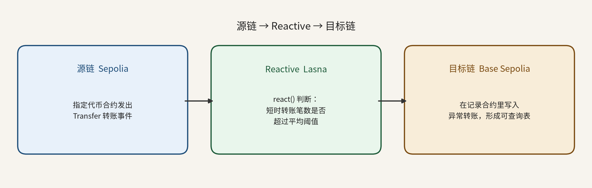

# 用例拆解卡：异常转账记录表

赛道 2 个人自动化。第一版先把短时异常转账记下来，形成一张可查询的表；买入或卖出是否集中出现，以后再根据这张表观察。

## 1. 监听哪条链、哪个合约的什么事件？

在 Ethereum Sepolia 上，监听一个事先指定的 ERC-20 代币合约发出的 `Transfer`（转账）事件。具体代币地址在部署时再填入，本卡先锁定事件类型。

## 2. 满足什么条件时触发？

当短时间内该代币的转账笔数超过预先设定的平均阈值时触发。例如：先统计一段时间内的平均笔数，若当前短窗口里的笔数明显高于这个平均值，就记为异常。

## 3. 在哪条链做什么动作？

在目标测试链 Base Sepolia 上的记录合约里，写入这些异常转账（时间、金额、转出地址、转入地址等），形成一张可查询的表。

第一版只负责记录。后续可以再根据这些记录，观察短时间内是否多数转入或转出，以及平稳一段时间后方向是否变化。

## 4. 如果不用 Reactive，你要怎么做？Reactive 让它简单在哪里，代价是什么？

如果不用 Reactive，我需要自己在电脑上 24 小时跑一个机器人，盯着 Sepolia 上的 `Transfer` 事件，短时笔数超过平均阈值后再调用 Base Sepolia 上的记录合约；或者自己手动刷新区块浏览器再抄录。电脑关机或程序出错，记录就会中断。

Reactive 让「盯盘」和「自动去目标链记账」由网络完成，我不必一直开着电脑。代价是：Reactive 合约需要保持足够余额，一旦出现欠款就会停止执行；触发条件必须预先写在合约里，第一版还不能自动完成完整的买卖波段判断；源链事件和目标链记账是两笔交易，不会保证同时成功或同时失败。

## 简图：源链 → Reactive → 目标链



```text
源链 Sepolia                     Reactive Lasna                      目标链 Base Sepolia
指定代币合约发出 Transfer    →    react() 判断短时笔数是否超平均阈值    →    写入异常转账，形成可查询表
```
